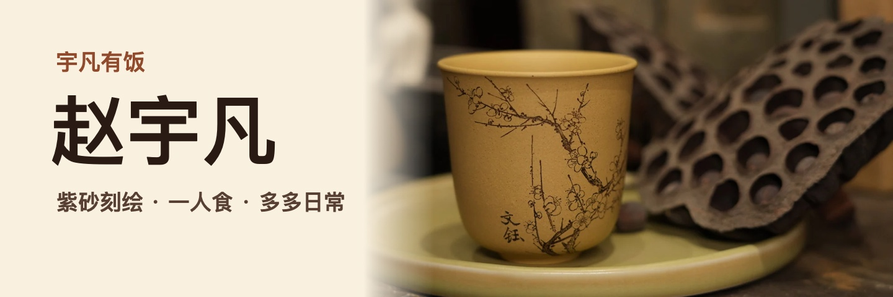

我是赵宇凡，也叫阿凡。2019 年开始做紫砂刻绘，在「宇凡有饭」记录我的一人食和小狗多多的日常。

## 看我的作品

- 花草、虫趣和人物，被我刻在一件件紫砂器上。[看紫砂刻绘作品](https://zyf990103-ops.github.io/self-introduction/#works)
- 用 60 秒认识我和多多。[看「宇凡有饭」自我介绍](https://zyf990103-ops.github.io/self-introduction/yufan-youfan/)
- 用 50 个网页案例记录字体、布局和交互。[翻阅网页设计手账](https://zyf990103-ops.github.io/self-introduction/design-keywords/)

[个人网站](https://zyf990103-ops.github.io/self-introduction/) · [网站源码](https://github.com/zyf990103-ops/self-introduction)
